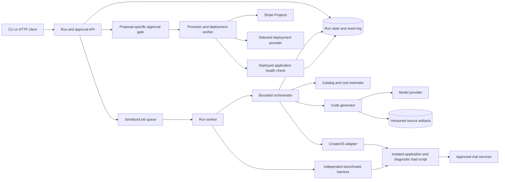
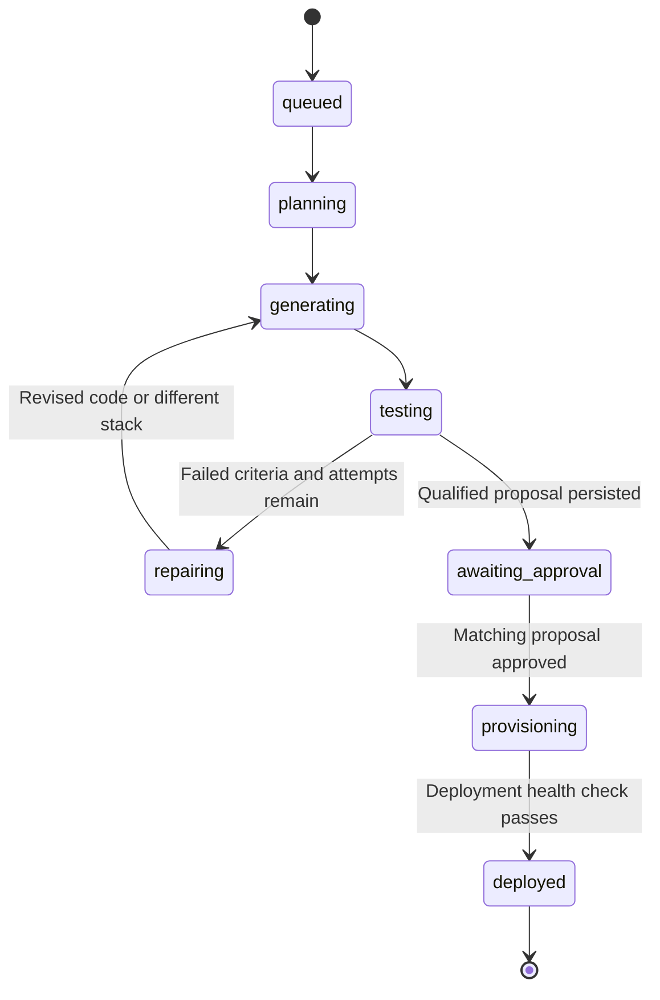
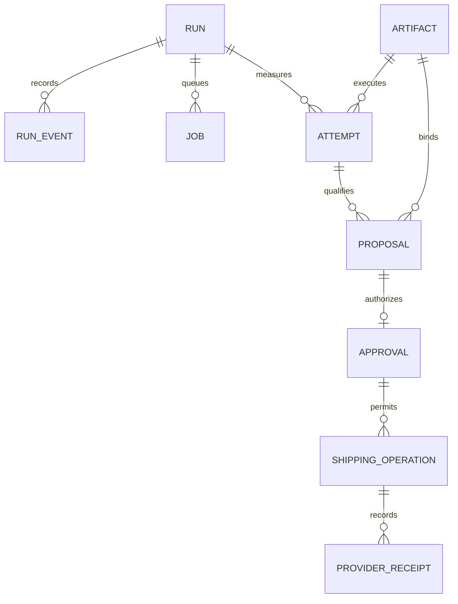

# Bounty-Box

Describe the app you want and set a budget. Bounty-Box picks the stack, writes the code, load-tests it in a CreateOS sandbox, swaps out parts that fail or cost too much, then buys the stack through Stripe Projects and hands you a live URL.

Built at **Build Agents That Run Code: CreateOS × Stripe Projects** (Oct 17, 2026) by Mohsen Sarrafan ([@mohsensc](https://github.com/mohsensc)) and Stefan Ilas ([@StefanIlas1](https://github.com/StefanIlas1)).

## What it does

1. **Brief:** you give it an app and a budget, e.g. "A waitlist app with email signups that handles 1,000 users, for under $30 a month."
2. **Draft a stack:** it picks candidate services from the Stripe Projects catalog (database, key-value store, host).
3. **Write and run:** it writes the app plus a load-test script and runs both in a CreateOS sandbox.
4. **Self-fix:** if the load test fails or projected cost exceeds the budget, it rewrites the code or swaps a stack component and runs again.
5. **Approve:** you review the final stack, monthly cost and test results.
6. **Buy and ship:** it runs `stripe projects add …` for each service, deploys, and returns a live URL.

See [design.md](design.md) for the full pitch, scope and risks.

Backend architecture: [system design and decisions](docs/backend-system-design.md) · [Miro architecture board](https://miro.com/app/board/uXjVEYwmnCA=/).

## Backend architecture diagrams

These diagrams describe the target architecture; implementation is in progress. See the [system design](docs/backend-system-design.md) for failure paths, limits, and architectural decisions, or open the [editable Miro board](https://miro.com/app/board/uXjVEYwmnCA=/).

### Backend components

The API persists runs and queues work; workers generate, benchmark, and ship approved artifacts.



[Diagram source](docs/diagrams/backend-components.mmd)

### Run lifecycle

The main success and repair path, with provisioning gated by proposal-specific approval.



[Diagram source](docs/diagrams/run-lifecycle.mmd)

### Approval and shipping

Shipping records provider receipts and verifies the deployed artifact. Unknown outcomes require reconciliation.

```mermaid
sequenceDiagram
    participant U as Operator
    participant A as API
    participant D as SQLite and artifacts
    participant W as Shipping worker
    participant S as Stripe Projects
    participant C as CreateOS deployment
    U->>A: Approve current proposal ID
    A->>D: Transaction: validate digest, expiry, price; reserve unique job
    A-->>U: Accepted snapshot
    W->>D: Claim job and persist provisioning intent
    W->>S: Provision selected services
    S-->>W: Resource IDs and receipts
    W->>D: Persist receipts
    W->>C: Configure runtime; upload approved artifact
    C-->>W: Deployment ID and URL
    W->>C: Check digest, health and signup persistence
    W->>D: Persist deployed URL and evidence
    Note over W,D: Unknown outcome stops automatic retry and requires reconciliation
```

[Diagram source](docs/diagrams/shipping-sequence.mmd)

### Data relationships

Attempts and proposals bind immutable artifacts; approvals authorize recorded shipping operations.



[Diagram source](docs/diagrams/data-relationships.mmd)

## Tech

- **Stripe Projects**: provisions and buys the chosen services (`stripe projects add`).
- **CreateOS Sandbox**: runs the generated app and load tests, with egress allowlisting, a live ingress URL, and pause/resume while waiting for approval.

## How to run

Setup instructions are added here as the build lands.
