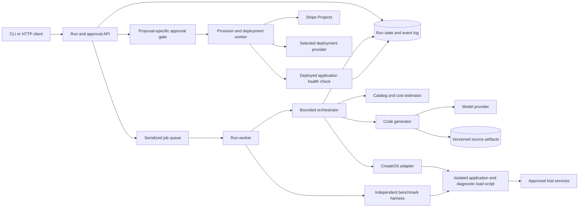
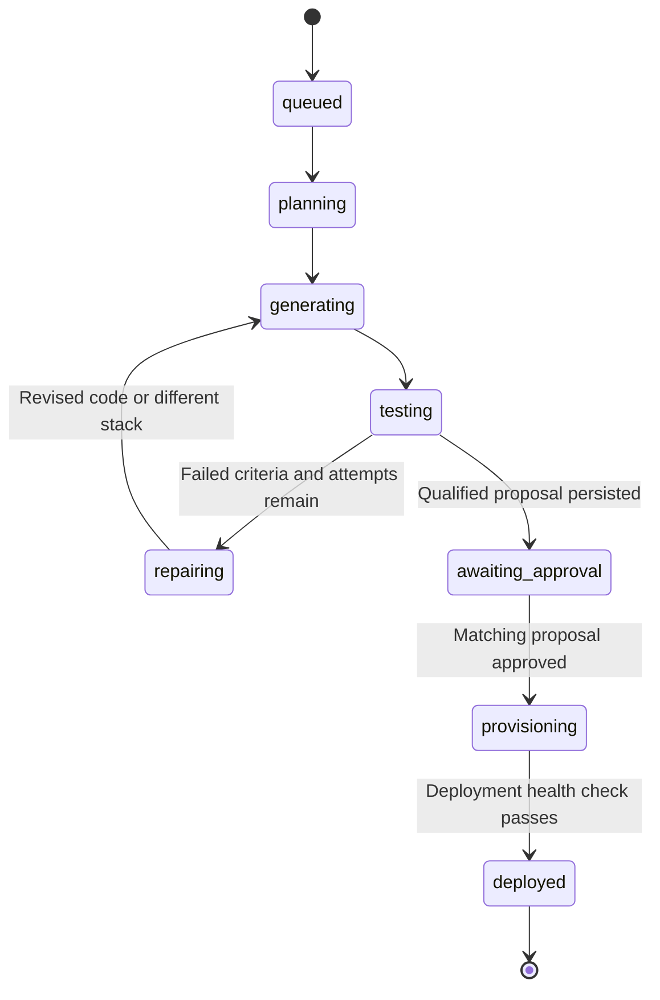
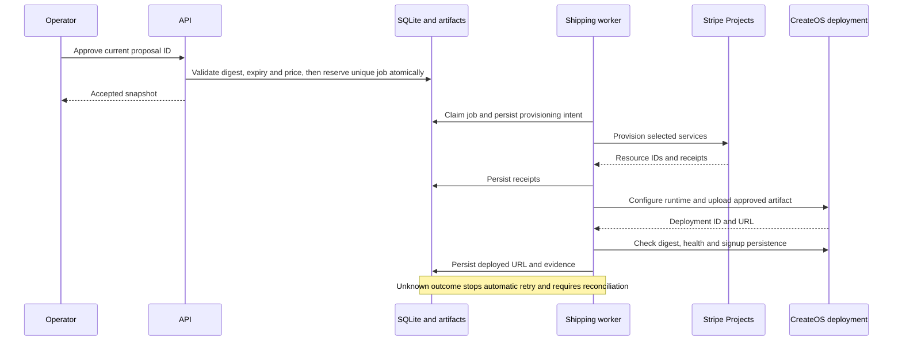
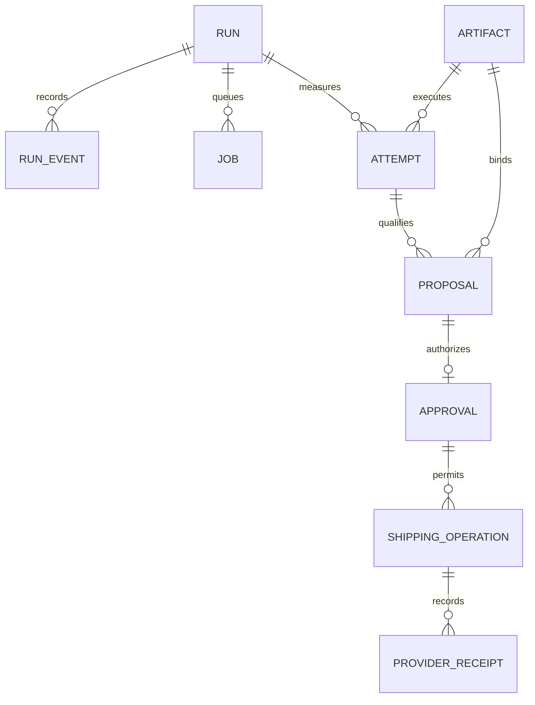

<div align="center">


### Building big under budget.

**Set the bounty. Get the build.** An AI agent that writes your app, load-tests it in a CreateOS sandbox, fixes its own code, and only then buys the stack through Stripe Projects.

[](https://projects.dev)
[](https://createos.sh)
[](#tech)

</div>

---

## Demo

<div align="center">

[](media/bounty-box-demo.mp4)

**[▶ Play the 2-minute demo](media/bounty-box-demo.mp4)**

</div>

## The problem

Shipping even a small app means picking a database, a host, a cache and an email provider, comparing a dozen pricing pages, and putting a card down on each one **before you know if any of it works**.

## What Bounty-Box does

1. **Set the bounty.** Describe the app and a monthly budget, e.g. *"A music app with playlists and play counts. Handle 1,000 listeners. Under $30 a month."*
2. **Draft a stack.** The agent picks real services from the **Stripe Projects** catalog and prices them against the budget.
3. **Write and run.** It writes the app *and* its own load test, then runs both in an isolated **CreateOS Sandbox** with egress locked to an allowlist.
4. **Fix itself.** When the test fails or the cost runs over, it reads the logs, rewrites the code or swaps a service, forks the sandbox to try fixes in parallel, and runs again.
5. **Approve.** You see the passing stack, the monthly total and the test evidence, and can open the live sandbox URL before paying anything.
6. **Buy and ship.** One approval runs `stripe projects add` for exactly the stack that passed and deploys it.

**Hardware mode:** for physical builds, the same loop sources parts, compares landed cost and delivery date, and orders the kit.

**Fair marketplace:** providers can list at a discount they choose, but they are only recommended when they beat the incumbents on the same sandbox test *and* on price. With no partner win, Bounty-Box uses the standard Stripe Projects catalog.

## Hackathon requirements

| Requirement | How Bounty-Box meets it |
| --- | --- |
| Agent writes and runs its own code | Generates the app and a load test, runs both, and repairs its code until the test passes |
| Stack set up with **Stripe Projects** | Services come from the Stripe Projects catalog and are provisioned with `stripe projects add` after approval |
| Code runs in a **CreateOS Sandbox** | Every generated build and load test runs in a CreateOS sandbox (`devbox:1`) with an egress allowlist, a live preview URL, fork for parallel fixes, and pause while awaiting approval |
| Demo video | [media/bounty-box-demo.mp4](media/bounty-box-demo.mp4) |
| Public repo | You are here |

## System design

### Backend components

The API persists runs and queues work; workers generate, benchmark, and ship approved artifacts.



### Run lifecycle

The main success and repair path, with provisioning gated by proposal-specific approval.



### Approval and shipping

Shipping records provider receipts and verifies the deployed artifact. Unknown outcomes require reconciliation.



### Data relationships

Attempts and proposals bind immutable artifacts; approvals authorize recorded shipping operations.



Diagram sources live in [`docs/diagrams/`](docs/diagrams). Editable board: [Miro](https://miro.com/app/board/uXjVEYwmnCA=/).

## Run it

Requirements: Node 22, the Stripe CLI with the Projects plugin, and a CreateOS API key.

```bash
# backend
npm install
cp .env.example .env.backend.local     # then fill in values
stripe projects env --pull             # pulls provider credentials
npm run dev                            # API
npm run worker                         # run worker (second terminal)

# web app
cd web && npm install && npm run dev
```

The web app runs a scripted demo by default; switch to live mode at `/app?mode=live` once the backend is up. `npm test` runs the backend, orchestrator, benchmark and provider checks.

## Tech

- **Stripe Projects** for the service catalog, provisioning and billing
- **CreateOS Sandbox** (`@nodeops-createos/sandbox`) for isolated runs, egress control, live URLs, fork and pause
- **TypeScript / Node 22** backend: run API, job queue, orchestrator, benchmark harness
- **React + Vite + Tailwind** web app
- **Hardware mode:** CadQuery / OpenSCAD, three.js, KiCad, eBay Browse API

## Team

| | |
| --- | --- |
| **Mohsen Sarrafan** | [@mohsensc](https://github.com/mohsensc) |
| **Stefan Ilas** | [@StefanIlas1](https://github.com/StefanIlas1) |

---

<div align="center">

Built in one day at **[Build Agents That Run Code: CreateOS × Stripe Projects](https://createos.sh/hackathon)**, October 17, 2026.
Thanks to **CreateOS** and **Stripe** for the tools, credits and a great event.

</div>
