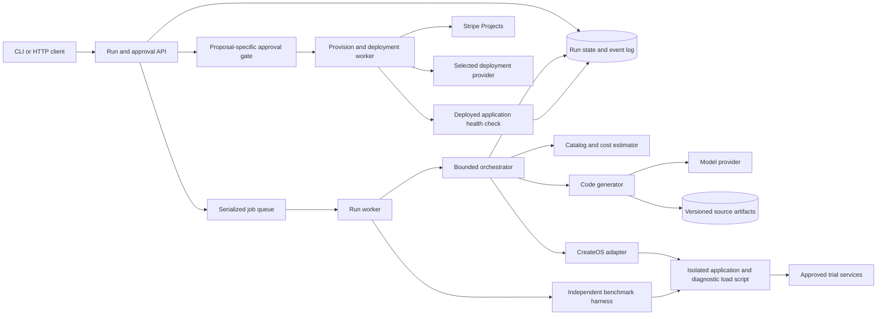
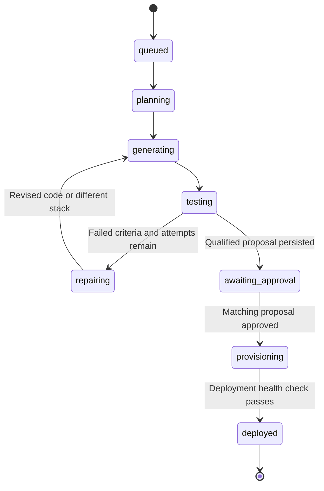
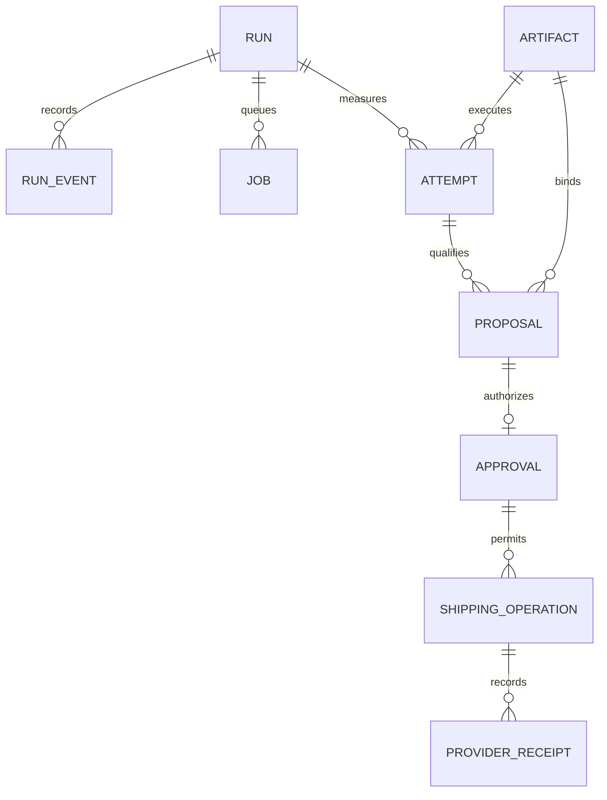

# Bounty-Box backend system design

Date: 2026-10-17. Status: selected MVP architecture, with partial implementation.
Miro: [Bounty-Box — Backend Architecture & Execution Design](https://miro.com/app/board/uXjVEYwmnCA=/).
Source of product requirements: [README](../README.md) and [product design](../design.md).
Source of application interfaces: [shared contracts](../src/lib/contracts.ts).
Frontend is outside the current assignment. A CLI or HTTP client can exercise every backend operation.

## 1. Product objective and success criteria

A user describes a narrow application, sets a monthly infrastructure budget,
and states expected usage. Bounty-Box selects candidate stacks, writes application
and load-test code, executes them inside CreateOS, repairs code or swaps stack
components based on measured evidence, obtains approval, provisions through
Stripe Projects, deploys the approved artifact, and returns a verified live URL.

The MVP supports one waitlist application type and a small verified service
catalog. It must demonstrate actual generation, execution, and an evidence-based
repair or swap. Vendor negotiation, referral payments, shared hosting, and a
general-purpose application builder are future scope.

Success requires all of the following:

- The tested application revision is the revision approved and deployed.
- The selected stack passes explicit performance thresholds within the estimated budget.
- Approval authorizes a specific proposal; changing cost, services, or artifact invalidates it.
- Stripe Projects performs supported provisioning; deployment is a separately verified operation.
- A health check succeeds at the final application URL before the run is marked deployed.
- Fixture runs and local substitutes never masquerade as live provider evidence.

## 2. Architecture and trust boundaries

Use a modular backend with an API process and one dedicated Node.js worker on
the same machine. The API manages runs and approval. The serialized worker calls
the orchestrator, generator, sandbox, catalog, and shipping adapters. SQLite stores
the durable queue and run state; source artifacts stay on local disk. Do not depend
on an HTTP request remaining open while a run executes. Multiple machines and an
external queue are future production evolution.



The diagram describes responsibilities, not independent microservices.

| Boundary | Responsibility | Important constraint |
| --- | --- | --- |
| API and run service | Validate inputs, persist jobs, authorize reads and mutations | Production requires authenticated run ownership; demo binds locally |
| Orchestrator | Select candidates, generate, test, repair/swap, propose | No purchasing; bounded attempts and cancellation |
| Generator | Produce structured files, startup commands, load-test commands | Model output is untrusted; validate paths, size, commands and revision |
| Catalog | Normalize services, costs, assumptions and sources | No invented provider IDs or unsupported discounts |
| Sandbox adapter | Enforce isolation, upload files, execute, capture evidence, destroy | Only scoped application credentials enter generated code |
| Approval gate | Match current proposal and approved artifact | Duplicate approval must not duplicate provisioning |
| Shipping worker | Provision, deploy approved bytes, verify URL | Persist receipts; reconcile uncertain provider results before retrying |
| State/artifact storage | Durable state, events, source revisions, operation receipts | Public run snapshots exclude credentials and internal source secrets |

The localhost agent coordination board at port 4317 is a **development tool**.
It is not the product API, runtime queue, approval service, or production datastore.

## 3. End-to-end execution

1. Accept `Brief`: description, monthly budget, expected users, explicit concurrency,
   test duration, p95 latency ceiling and maximum error rate. Expected users and
   simultaneous requests are distinct quantities.
2. Persist a queued run before returning `202`. Admission control caps pending
   jobs and validates load limits. The worker acquires the single execution slot.
3. Fetch catalog candidates with cost sources, usage assumptions, required
   environment-variable names and live/fixture mode. Filter unaffordable options.
4. Generate a revision of application source and a load script. Validate the
   output and store an immutable artifact plus content digest.
5. Resolve trial-service access. Configure egress restrictions before executing
   generated code. Upload files, start the app, verify readiness, run the diagnostic
   script, and collect authoritative metrics with the independent worker harness.
6. Persist actual request count, throughput, p95 latency, error rate, duration,
   sanitized logs and the environment that was measured. Destroy the sandbox.
7. Evaluate the measured result against the brief. Supply actual failure evidence
   to a repair generation, or move to another eligible stack. Default total cap:
   three attempts, with an independently enforced account/day execution budget.
8. Persist a successful proposal and its selected artifact atomically. Release the
   execution slot while waiting for approval; no sandbox needs to remain alive.
9. Accept approval only for the current proposal. Atomically transition to
   provisioning and enqueue one shipping operation for that proposal.
10. Provision supported services through Stripe Projects, record receipts, deploy
    the approved artifact through a verified provider path, and health-check it.
    Persist the durable URL only after verification succeeds.

### A critical dependency: testing before purchasing

Real candidate measurements require existing evaluation credentials, a documented
trial path, or pre-provisioned free-tier resources. This must be resolved before
claiming that the system benchmarked a real vendor stack.

Running an in-memory or local database in CreateOS is useful for code validation,
but does not establish the latency, limits, reliability, or cost of a remote managed
database. If only substitutes are available, label the evidence accordingly and
do not present it as a completed real-vendor comparison. Add an environment
fingerprint and evidence scope to persisted test records before supporting this.

Generated load scripts can also be wrong. A backend-controlled harness must validate
the workload, collect or independently verify measurements, and reject malformed,
non-finite, empty, shortened, or mode-mismatched results. JSON emitted by generated
code alone is insufficient proof of a passing benchmark.

## 4. Lifecycle and approval



Additional transitions: any nonterminal phase can fail; queued, active testing,
and awaiting-approval runs can be cancelled. The repair cap or lack of qualifying
candidates produces `failed`, with a specific reason and retained evidence.

Cancellation during provisioning is not a financial rollback. Stop further work,
reconcile any in-flight operation, retain service IDs and costs, and report partial
resources. The current public status union is too small to fully represent partial
provisioning; add a shipping substatus/receipt record before enabling live purchase.

Approval binds run owner, proposal ID, artifact digest, catalog version, service
IDs, estimated cost and assumptions. A stale proposal returns a conflict. If price
or resource selection changes after approval, stop and request renewed approval.

For the MVP, sandbox cleanup on each attempt is preferable to holding a paused
sandbox through a potentially long approval wait. Pause/resume is an optional
extension contingent on verified provider support and available quota.

## 5. API contract

These paths are specified in `src/lib/contracts.ts`; this document does not claim
that routes have already been implemented.

| Method and route | Input | Result |
| --- | --- | --- |
| `POST /api/runs` | `{ brief, mode: "live" or "fixture" }` | `202 RunSnapshot`; persist and queue |
| `GET /api/runs/:id` | Run ID | `200 RunSnapshot` with ordered events |
| `POST /api/runs/:id/approve` | `{ proposalId }` | Current snapshot after accepted approval |
| `POST /api/runs/:id/cancel` | Run ID | Snapshot with cancellation outcome |

Errors use `{ error: string }`. Proposed semantics: `400` invalid input, `404`
unknown/inaccessible run, `409` stale approval or incompatible state, `429` admission
limit, and `503` unavailable required configuration. Repeated approval of the same
already-accepted proposal returns its current result without repeating side effects.

Add an idempotency key to run creation so client retries do not consume extra
sandbox quota. Bound request size, description length, budget, concurrency and test
duration. Keep evidence polling read-only; it must never restart jobs.

## 6. Persistence model

Proposed MVP storage: a dedicated application SQLite database and local artifact
directory, both ignored by Git. Do not reuse `.coordination/board.sqlite3`.

| Entity | Key fields | Purpose |
| --- | --- | --- |
| Run | ID, owner, brief, mode, status, timestamps, version | Lifecycle and optimistic concurrency |
| RunEvent | Run ID, sequence ID, stage, sanitized message | Ordered progress and explanation |
| CandidateSnapshot | Run ID, stack ID, service IDs, price sources, assumptions | Reproducible selection and cost basis |
| ArtifactRevision | Run ID, revision, digest, path, stack ID | Exact generated bytes to test and deploy |
| Attempt | Run ID, attempt number, artifact digest, environment, result, decision | Evidence for repair/swap |
| Proposal | ID, selected attempt, digest, cost, catalog version | Immutable approval target |
| Approval | Proposal ID, actor, timestamp, accepted cost basis | Authorization audit |
| ShippingOperation | Proposal ID, phase, idempotency key, receipts, error | Prevent duplicate resource creation |

Use transactions for state changes and associated events. Persist the selected
artifact before exposing `awaiting_approval`; otherwise a crash could leave an
approvable proposal with no deployable source. Keep secret values in the process
environment or a secret store, never in these records.

On restart, identify interrupted jobs. Do not blindly rerun a sandbox attempt or
purchase. MVP recovery can mark interrupted testing as failed with an explicit
retry instruction, then clean up recorded sandbox IDs. Interrupted shipping must
reconcile recorded provider operations and resources before accepting a retry.

## 7. Selection, budget and execution limits

- Budget is an estimate of recurring infrastructure spend under disclosed usage
  assumptions; it is not a guarantee against provider overages.
- Track agent/model/sandbox development costs separately from the deployed app's
  monthly cost. Include known one-time charges in the approval summary.
- A passing candidate needs valid measured requests, throughput, sufficient test
  duration, acceptable p95 and error rate, plus an affordable estimated stack.
- Partner candidates face the same thresholds and must beat the cheapest verified
  qualifying non-partner alternative. Without a qualifying comparison, do not
  assert the partner trust rule has been satisfied.
- Execution must be globally serialized for the current demo constraints, not
  merely sequential inside each individual run. Paused resources may still occupy
  capacity; verify account quotas before live use.
- Enforce command timeout, overall run timeout, log/file/output limits, maximum
  attempts, account execution budget and queue size outside model control.

## 8. Failure handling and security

| Failure | Required response |
| --- | --- |
| Invalid model output | Reject before execution; bounded regeneration or clear failure |
| App fails to start | Capture sanitized diagnostics, clean up, feed evidence into repair |
| Load test fails | Retain measurements; repair or swap within the attempt cap |
| Catalog/pricing unknown | Exclude unsupported candidate or block approval explicitly |
| Persistence fails | Stop external work; do not publish unpersisted approval state |
| Provider request times out | Reconcile resource/operation IDs before retrying mutation |
| Provisioning partially succeeds | Record existing resources and costs; do not call it deployed |
| Deployment health check fails | Retain receipts and evidence; provide explicit recovery action |
| User cancels | Abort active commands, clean up sandbox, preserve evidence |

Reject absolute/traversing artifact paths and restrict file counts and total bytes.
Execute generated commands only in the sandbox. Never interpolate generated or
user text into host shell commands. Provisioning uses validated service IDs and
argument arrays. Generated applications receive only scoped trial/runtime secrets,
not Stripe administration, model-provider or CreateOS management credentials.

Treat public preview URLs as exposure: use non-sensitive demo data, expire them,
and avoid returning URLs after the underlying sandbox has been destroyed.
The production API additionally requires authentication, authorization, request
limits, secret isolation per user and a retention/deletion policy before exposure.

## 9. Implementation snapshot and ownership

Snapshot taken while parallel agents are working; statuses may change quickly.

| Component | Observed status | Owner |
| --- | --- | --- |
| Product goals and interface types | Present in repo | Agent 1 |
| Local development coordination service | Running and smoke-checked | Agent 1 |
| Orchestration loop | Source present; integration validation pending | Agent 2 |
| Product API, persistence, queue, generator | Planned; not yet present at this snapshot | Agent 1 |
| CreateOS/Stripe/catalog adapters | Agent working on verified integration design | Agent 3 |
| Approval shipping path and durable deployment | Proposed; provider path must be verified | Agent 1 + agent 3 |
| Frontend | Deferred by user direction | None |

The `orchestrateRun` boundary accepts a `RunSnapshot`, injected `Catalog`, `Generator`
and `SandboxRunner`, an abort signal, attempt cap, and awaited snapshot callback.
It returns the final run and optional selected `GeneratedApp`. The caller owns
durability, global serialization, approval and provisioning.

## 10. Selected architectural decisions

These are implementation decisions, not assertions that credentials are configured
or live integration checks have passed.

| ID | Decision | Rationale and implementation requirement |
| --- | --- | --- |
| ADR-01 | TypeScript modular monolith; Next.js route handlers in Node runtime; Node 22 baseline | Preserve agreed API paths and isolate adapters. No frontend or edge runtime. Background jobs run in a separate Node worker process, not request handlers. |
| ADR-02 | SQLite WAL for product state and durable job queue, using explicit transactions | Single-machine MVP needs no Redis or hosted control database. A separate process survives API request cancellation. Production migration: PostgreSQL plus object storage. |
| ADR-03 | One worker lease across both test and shipping jobs; max five queued jobs | Respect constrained sandbox capacity. SQLite claims serialize workers; unique job keys prevent duplicate approval shipping. No concurrent provider initialization. |
| ADR-04 | Content-addressed files under `.bounty-box/artifacts/<sha256>/`; write temp then rename | A proposal identifies exact source bytes and dependency lockfile. Credentials are runtime injection, never artifact content. |
| ADR-05 | Two candidate stacks: CreateOS host + Neon Postgres; CreateOS host + Turso/libSQL | Keep host constant and swap only persistence. Both database slugs and `createos/project` are listed in the Stripe Projects catalog. Actual account eligibility and price must be checked before selection. |
| ADR-06 | Pre-provisioned operator-owned trial databases; isolated run namespace; synthetic data only | Avoid buying before approval. Application sees only scoped trial credentials. Missing trials stop live mode; fixture mode remains explicitly labeled. |
| ADR-07 | Generated app: small Node HTTP waitlist service, storage adapter interface, pinned dependency lockfile and Dockerfile | One app shape makes repairs and storage swaps tractable. Endpoints: `GET /health`, `POST /signups`, and bounded `GET /stats`; unique normalized email enforced in the database. |
| ADR-08 | OpenAI Responses API behind `Generator`; strict schema plus semantic validation | Require `OPENAI_API_KEY` and explicit `OPENAI_MODEL` in setup. Model choice is configuration, never hardcoded to an unverified account entitlement. At most one generation request per attempt; incomplete/refused output fails clearly. |
| ADR-09 | Authoritative benchmark harness runs in the trusted worker against temporary sandbox ingress | Generated load script also runs in sandbox for diagnostics. Only independent harness metrics qualify a proposal; use secret per-run ingress token, synthetic emails, and close ingress on cleanup. Never assume app-reported metrics are trustworthy. |
| ADR-10 | Default demo: 1,000 expected users, concurrency 10, 30 seconds, p95 <= 500 ms, errors <= 1% | Defaults are test assumptions, not a capacity promise. Bound concurrency to 50 and duration to 120 seconds; allow explicit overrides within those limits. Warm-up is excluded and recorded. |
| ADR-11 | Three total attempts, 90-second startup timeout, 180-second generation timeout, 15-minute run deadline | All enforced outside model control. Log cap 256 KiB per attempt, source cap 1 MiB / 50 files. Retry transient read failures at most twice; do not blindly retry purchases. |
| ADR-12 | Approval expiry 15 minutes and revalidation before shipping | Approval binds proposal, artifact digest, services, prices and catalog snapshot. Any changed assumption requires a new proposal. Product API accepts explicit approval; it never purchases merely because tests pass. |
| ADR-13 | Stripe Projects provisions; CreateOS CLI deploys an upload project from the approved artifact directory | CreateOS documents upload deployments. Verify mapping from Stripe resource receipt to CreateOS project ID and project type before mutation. Do not deploy from latest Git HEAD. Record URL and provider deployment ID. |
| ADR-14 | Shipping is a persisted saga: reserve → provision → configure → deploy → verify | Separate receipts and idempotency key for each phase. Ambiguous timeouts enter reconciliation; partial resources are reported, not silently deleted or purchased twice. |
| ADR-15 | Local-only API on 127.0.0.1:3000 with generated bearer token; no permissive CORS | Single operator demo. Do not expose publicly without authenticated tenant ownership and quotas. Local coordination on port 4317 remains separate. |
| ADR-16 | Fixtures are opt-in, cannot invoke live shipping, and never satisfy live evidence gates | Deterministic demos are allowed only with visible fixture mode. Live repair demonstrations must use actual failures. |

Implementation deltas required from current contracts: persist `artifactDigest`,
`catalogSnapshotId`, `approvalExpiresAt`, `evidenceScope`, trial environment identity,
benchmark harness version and independent metric provenance. Add a shipping
substatus and receipts without claiming that `cancelled` undoes provisioned resources.
Agent 1 owns these changes; workers must coordinate before modifying shared types.

### Worker lease and recovery rules

Acquire the singleton lease in a transaction; heartbeat every 10 seconds with a
60-second expiry. A lost lease prevents new side effects. Lease expiration alone
does not prove an external command stopped: the successor reconciles recorded
sandbox/deployment IDs before admitting another execution. Record the intended
operation before the provider call, then its receipt immediately after success.
Unknown-outcome provisioning jobs remain blocked for reconciliation, never auto-replayed.

### Purchase and pricing policy

Default to no paid provisioning. Unknown prices are ineligible, not zero. Retrieve
the current catalog and account quote/configuration at setup and before approval;
store source and timestamp. Use documented account free tiers only after eligibility
is established. Recurring estimates include host and database assumptions; billable
overages are disclosed. A positive charge requires a concrete operator-approved cap.
Benchmark/model expenses have a separate configured run budget; missing budget or
credentials blocks live execution. This document authorizes no spend.

### Provisioning and deployment gates

Architecture is selected; these are operational prerequisites, not unanswered
design questions: model API access; CreateOS sandbox and platform authentication;
Stripe Projects project/login; scoped trial credentials; verified provider pricing;
and an upload-project deployment smoke check. Fail preflight before generation or
purchase when a required prerequisite is absent. Setup never logs secret values.

After shipping, verify `GET /health` reports the approved digest, then perform a
synthetic signup persistence check and remove that probe record. A sandbox benchmark
does not certify production-host capacity: label production verification as a
functional smoke test unless a separate production load test was actually run.

### Sources for provider-specific decisions

- [Stripe Projects catalog and CLI](https://projects.dev/llms.txt): provision service slugs, structured CLI output, and credential handling.
- [CreateOS CLI quickstart](https://createos.sh/docs/CLI/Getting-Started/): upload-type project deployment and returned live URL.
- [CreateOS Sandbox SDK quickstart](https://createos.sh/docs/Sandbox/SDK/Quickstart/): client configuration, sandbox execution and explicit cleanup.
- [Neon driver](https://neon.com/docs/serverless/serverless-driver) and [Turso TypeScript client](https://docs.turso.tech/sdk/ts/reference): selected generated-app database adapters.
- [OpenAI structured outputs](https://developers.openai.com/api/docs/guides/structured-outputs?api-mode=responses): schema-constrained generation with explicit incomplete/refusal handling.

## 11. Shipping sequence

```mermaid
sequenceDiagram
    participant U as Operator
    participant A as API
    participant D as SQLite and artifacts
    participant W as Shipping worker
    participant S as Stripe Projects
    participant C as CreateOS deployment
    U->>A: Approve current proposal ID
    A->>D: Transaction: validate digest, expiry, price; reserve unique job
    A-->>U: Accepted snapshot
    W->>D: Claim job and persist provisioning intent
    W->>S: Provision selected services
    S-->>W: Resource IDs and receipts
    W->>D: Persist receipts
    W->>C: Configure runtime; upload approved artifact
    C-->>W: Deployment ID and URL
    W->>C: Check digest, health and signup persistence
    W->>D: Persist deployed URL and evidence
    Note over W,D: Unknown outcome stops automatic retry and requires reconciliation
```

## 12. Data relationships



## 13. Miro board layout

The board link is at the top of this document. Browser publishing is used because
the newly connected plugin is not exposed to this session. Local Markdown is the
canonical detailed text; the board presents the same decisions visually.
Published board contents:

- [00 — Backend system design & decisions](https://miro.com/app/board/uXjVEYwmnCA=/?focusWidget=3458764687578774207): product goal, 16 selected decisions, API/data contract,
  execution bounds, approval, recovery, setup gates and official source links.
- [01 — Backend components & trust boundaries](https://miro.com/app/board/uXjVEYwmnCA=/?focusWidget=3458764687578774694)
- [02 — Run lifecycle, repair & approval](https://miro.com/app/board/uXjVEYwmnCA=/?focusWidget=3458764687578840391)
- [03 — Approval, shipping & recovery sequence](https://miro.com/app/board/uXjVEYwmnCA=/?focusWidget=3458764687578840795)
- [04 — Data model & immutable approval chain](https://miro.com/app/board/uXjVEYwmnCA=/?focusWidget=3458764687578904011)

Diagrams are native Mermaid-backed Miro diagrams, editable through their Code
panel. Purple marks external providers, amber approval/decision gates, green
artifacts/evidence/success, and red failure/reconciliation paths. Board overview
is arranged as documentation at left and diagrams in two rows to the right.
